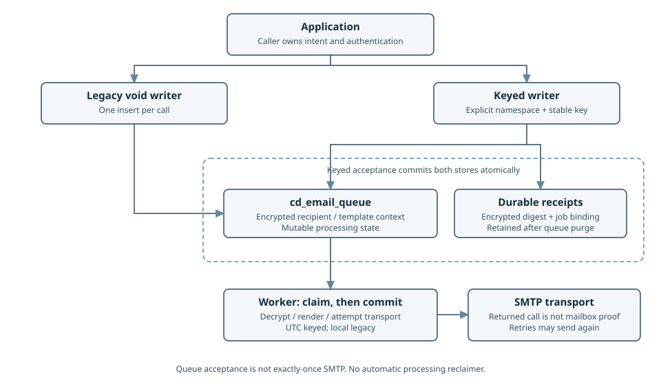
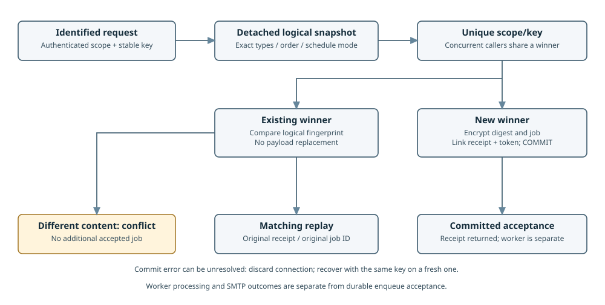
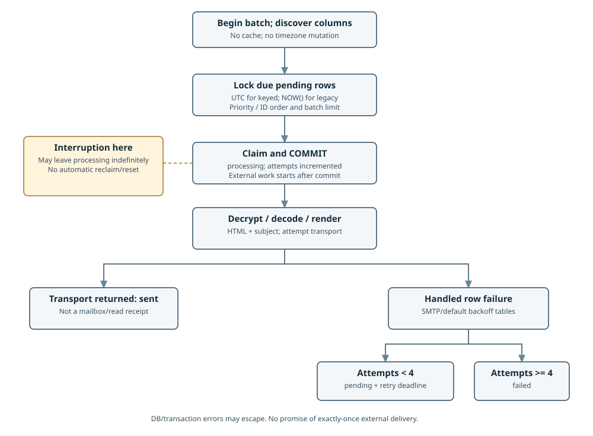

# Maatify Email Delivery

[](https://packagist.org/packages/maatify/email-delivery)
[](https://packagist.org/packages/maatify/email-delivery)
[](LICENSE)


[](CHANGELOG.md)
[](SECURITY.md)


[](SECURITY_AUDIT.md)


[](https://packagist.org/packages/maatify/email-delivery)


---

## Overview

**Maatify Email Delivery** is a standalone module for rendering, queueing, and sending transactional emails.

It provides:
- Async transactional email delivery
- Twig email rendering
- Queue-based delivery
- SMTP transport via PHPMailer
- Background worker processing
- Encrypted payload storage via `maatify/crypto`
- Framework-agnostic architecture

## Why This Library

This library solves several common problems in web applications:
- Synchronous email sending blocking requests and slowing down user responses.
- Unreliable delivery in high-volume systems when SMTP servers drop connections.
- Lack of templating systems for clean, maintainable transactional email layouts.
- Difficulty scaling email infrastructure.

By decoupling the process, the library introduces an robust **async email pipeline**.

## Features

- Async email queue
- Twig template rendering
- SMTP transport (PHPMailer)
- Background worker processing
- Encrypted queue payloads
- Retry mechanism for failed emails
- **Reply-To support** — optional Reply-To header for admin notifications ¹
- Framework-agnostic design
- Designed for transactional email systems

¹ *Available since v1.1.0*

## Quick Examples

### Basic usage — customer-facing email

```php
use Maatify\EmailDelivery\Queue\DTO\EmailQueuePayloadDTO;
use Maatify\EmailDelivery\Queue\PdoEmailQueueWriter;

// 1. Initialize Queue Writer
$queueWriter = new PdoEmailQueueWriter($pdo, $cryptoProvider, $cryptoContext);

// 2. Create Payload
$payload = new EmailQueuePayloadDTO(
    templateKey: 'welcome',
    language: 'en',
    context: ['name' => 'John Doe']
);

$email = 'john.doe@example.com';

// 3. Enqueue the email
$queueWriter->enqueue(
    entityType: 'user',
    entityId: '123',
    recipientEmail: $email,
    payload: $payload,
    senderType: 1,
    priority: 10
);
```

### Admin notification with Reply-To (v1.1.0+)

```php
use Maatify\EmailDelivery\Queue\DTO\EmailQueuePayloadDTO;

// Payload with optional replyTo — email goes TO the admin,
// but Reply-To is set to the customer so admin replies reach them.
$payload = new EmailQueuePayloadDTO(
    templateKey: 'admin_notification',
    language: 'en',
    context: [
        'customer_name'    => 'Ahmed',
        'customer_email'   => 'customer@example.com',
        'customer_message' => 'I need help with my account.',
    ],
    replyTo: 'customer@example.com',
);

$queueWriter->enqueue(
    entityType: 'contact_form',
    entityId: '456',
    recipientEmail: 'admin@example.com',
    payload: $payload,
    senderType: 1,
    priority: 5
);
```

## Architecture Overview

The email delivery pipeline relies on four main components:
- **Renderer:** Compiles data and Twig templates into HTML/Text content.
- **Queue Writer:** Securely encrypts and stores the payload in the database queue.
- **Worker:** A background process that decrypts, renders, and attempts delivery.
- **Transport:** The SMTP layer that physically sends the email.

```text
Application
      ↓
Queue Writer
      ↓
Database Queue
      ↓
Email Worker
      ↓
SMTP Transport
```

## Email Delivery Pipeline

```text
Request → Queue → Worker → SMTP → Recipient
```

This system intentionally decouples email sending from application requests. Your application immediately responds to the user while the background worker handles the potentially slow and error-prone process of rendering and SMTP transmission.

## System Diagrams

### Architecture


### Email Flow


### Worker Lifecycle


## Installation

```bash
composer require maatify/email-delivery
```

## Documentation

Book:
- [docs/book/README.md](docs/book/README.md)

Guides:
- [docs/how-to/README.md](docs/how-to/README.md)

Examples:
- [docs/examples/README.md](docs/examples/README.md)

## Ecosystem

This package is part of the **Maatify Ecosystem**.

It relies on the `maatify/crypto` dependency to provide robust encryption. Encryption is used specifically for queue payload security, ensuring that sensitive transactional data (like password reset tokens or PII) remains unreadable if the queue database is ever compromised.

## License

MIT License

## Explicit idempotent enqueue (unreleased)

The legacy `enqueue(): void` remains unchanged and may queue identical emails repeatedly.
Use the additive `IdempotentEmailQueueWriterInterface` when the caller has a stable request identity:

```php
use Maatify\EmailDelivery\Queue\DTO\EmailEnqueueRequestDTO;
use Maatify\EmailDelivery\Queue\DTO\EmailQueuePayloadDTO;
use Maatify\EmailDelivery\Queue\PdoIdempotentEmailQueue;

// Application connection setup, not a hidden mutation by the library:
$pdo->setAttribute(PDO::ATTR_ERRMODE, PDO::ERRMODE_EXCEPTION);
$pdo->exec("SET SESSION time_zone = '+00:00'");
$queue = new PdoIdempotentEmailQueue(
    $pdo, $cryptoProvider, $cryptoContext,
    fingerprintContext: 'email:queue:enqueue-fingerprint:v1',
);
$request = new EmailEnqueueRequestDTO(
    consumerNamespace: 'authenticated-application',
    requestKey: 'stable-request-identity', // reuse EXACTLY this key after a lost reply
    entityType: 'user',
    entityId: '123',
    recipientEmail: 'fixture@example.invalid',
    payload: new EmailQueuePayloadDTO(['name' => 'Example'], 'welcome', 'en'),
    senderType: 1,
);
$receipt = $queue->enqueueOnce($request);
$observed = $queue->find($request->consumerNamespace, $request->requestKey);
```

A receipt confirms committed **queue acceptance**, not mailbox delivery or exactly-once SMTP.
Same namespace/key and logical content return the same receipt/job ID. Different content conflicts;
no existing job is overwritten. The namespace is not authentication: a service must derive it from
its authenticated caller. Never put PII or secrets in namespace/request keys.

Root context keys must be strings, as in the legacy DTO contract; nested lists/integer keys are
allowed. The new API preserves array iteration order and scalar types: reordering a map, changing
an integer to a float/string, or changing case/whitespace changes logical content. Objects/resources,
non-finite floats and invalid UTF-8 are rejected. Context limits are depth 32, 10,000 values and 1 MiB
of key/value string bytes. Explicit schedules denote a UTC instant at whole-second precision;
`null` denotes Immediate, whose actual UTC time is frozen only on first acceptance. Repeating `null`
later does not reschedule or conflict, but `null` and an explicit time are distinct.

### Schema and key retention

- Fresh installation: apply `schema/mysql/001_email_queue.sql`, then `002_email_enqueue_receipts.sql`.
- Existing legacy queue: apply `002_email_enqueue_receipts.sql` and the **one-time**
  `003_email_queue_receipt_binding.sql` before calling the new API. Do not run 003 after fresh 001.
- Both tables must be InnoDB with the complete binary identity/unique constraints. The library checks
  compatibility before writes; it does not silently ALTER incompatible installations.
- `enqueue_receipt_id` is package-owned and immutable. Legacy inserts leave it NULL and the existing
  worker ignores it. It prevents a reused numeric job ID from impersonating an old receipt's job.
- Receipts are retained indefinitely in this initial contract. Do not delete them or reuse their keys.
  Queue purge leaves receipt lookup available with `QueueMissing`; it never recreates a job or infers
  `Sent`. There is no automatic receipt pruner/backfill.
- The logical fingerprint is an **encrypted digest**, not a plaintext short-secret guessing oracle.
  Keep its supplied versioned crypto context stable and retain old fingerprint decryption keys while
  receipts exist. Missing old keys fail closed on replay; receipt lookup needs no decryption.

### Errors and transaction ownership

The new ports require an idle connection, autocommit enabled, `PDO::ERRMODE_EXCEPTION`, and an
explicit UTC session. They own their transactions and never commit/rollback a caller transaction.

- `InvalidArgumentException`: fix invalid identity/content; no retry with changed content on the same key.
- `EmailEnqueueConflictException`: the key already names different content. Investigate; do not overwrite.
- `EmailEnqueueUnavailableException`: no successful acceptance is reported. Database errors (including
  deadlocks) are not duplicate wins; preserve the key when retrying after recovery.
- `EmailEnqueueTransactionUnresolvedException`: discard the connection. A commit may already have
  reached the server even if the client saw an error. Reconcile the **same namespace/key on a new
  connection**; never compensate with another key or assume an apparent rollback proves nonacceptance.

`EmailEnqueueReceiptReaderInterface::find()` throws validation/unavailable/unresolved errors too;
`null` means no receipt in the requested scope, not a transport result. Returned queue state is a
current observation, not an external delivery receipt. See [ADR-010](docs/ADR-010-Idempotent-Email-Enqueue.md)
for the schema extension to ADR-008 and [the queue guide](docs/book/queue.md).

### Verification

`composer test` runs the normal suite and safely skips real-DB cases without configuration. CI also
runs the complete suite against MySQL on PHP 8.2/8.3/8.4 with `EMAIL_DELIVERY_IT_REQUIRED=1`.
For a **dedicated disposable** MySQL/MariaDB database ending in `_test`, configure
`EMAIL_DELIVERY_IT_DSN`, `EMAIL_DELIVERY_IT_USER`, and `EMAIL_DELIVERY_IT_PASS`. The integration tests
own/drop their two queue tables in that database; never point them at an existing application database.
No integration test connects to live SMTP.
