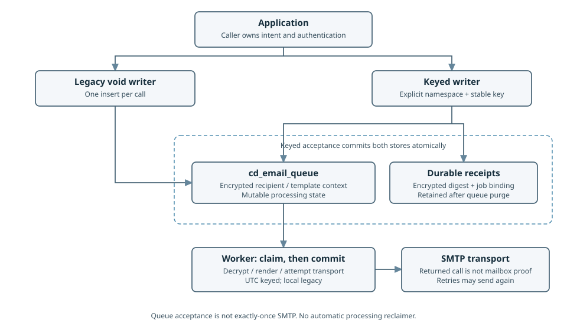
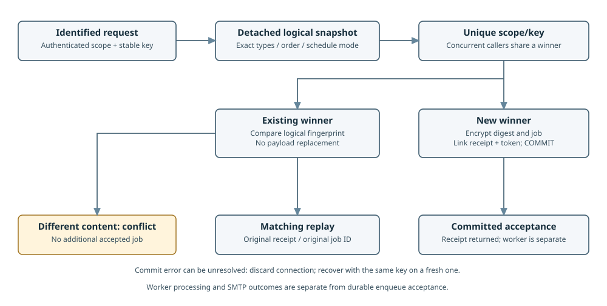

# Architecture

[Book](README.md) · [Keyed contract](../reference/idempotency.md)

The package owns email delivery storage, rendering and transport. Applications own intent, identities,
authorization, connection/key configuration, process supervision and any HTTP integration.

| Component | Implemented responsibility |
| --- | --- |
| `PdoEmailQueueWriter` | Encrypt and insert one job per call; legacy void API |
| `PdoIdempotentEmailQueue` | Atomically bind explicit scoped identity to one job/receipt; reject content conflict |
| `PdoSyntheticEmailStore` | Independent encrypted inert recording and bounded expiry cleanup; no worker handoff |
| `cd_email_queue` | Encrypted recipient/context plus scheduling and processing metadata |
| `cd_email_enqueue_receipts` | Durable identity, encrypted digest and original job/receipt link |
| `EmailQueueWorker` | Claim due pending batch, commit, decrypt/render, invoke transport, record outcome/retry |
| `TwigEmailRenderer` | Nonempty subject block and HTML body; no plain-text body generation |
| `SmtpEmailTransport` | PHPMailer SMTP call with configured TLS/SSL behavior and optional Reply-To |

The keyed acceptance transaction contains no SMTP call. Worker row locks protect batch claiming, not
the external side effect. A crash after claim can leave `processing`; a transport acceptance followed by
lost acknowledgement can be ambiguous. The library does not guarantee exactly-once SMTP or implement
automatic `processing` recovery. See [worker](worker.md) and [retry limits](retry-mechanism.md).

[ADR-008](../ADR-008-Email-Delivery-Independent-Queue.md) is the historical locked independent-channel
decision. [ADR-010](../ADR-010-Idempotent-Email-Enqueue.md) describes its implemented, unreleased
keyed storage extension; it does not move notification orchestration into this library.

Synthetic storage is a separate optional path, outside both delivery-flow diagrams above. See
[ADR-011](../ADR-011-Synthetic-Email-Recording.md) and the [contract](../reference/synthetic-recording.md).
