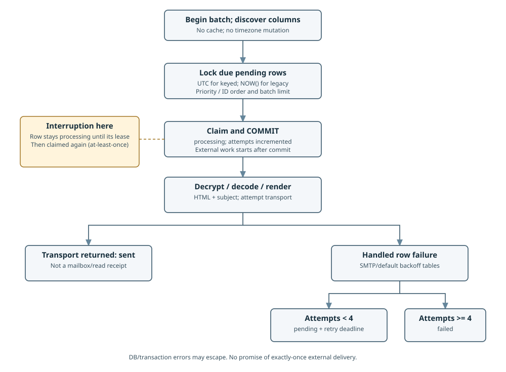

# Worker lifecycle and clocks

[Book](README.md) · [Worker setup](../how-to/setup-worker.md) · [Retry details](retry-mechanism.md)

`EmailQueueWorker::processBatch(int $limit=50): void` processes one batch; it is not a daemon.
The application supplies a connection, real crypto contexts, renderer, transport and PSR-3 logger.
Give the worker a connection factory, a `Closure(): PDO` that returns a new exception-mode connection
with your session settings, so that it can replace a connection the server closed. A `PDO` instance
still works but cannot reconnect. On MySQL/MariaDB every worker connection needs autocommit enabled
(the server default): its status writes must commit on their own. The worker checks
`@@SESSION.autocommit` on each factory connection when it is created, and on a `PDO` instance once
before its first claim, and throws `UnexpectedValueException` before claiming or writing anything when it
is off. It never changes the setting. The worker's transaction ownership differs from the guarded
[keyed enqueue ports](../reference/idempotency.md); do not wrap a worker batch in a caller transaction.

1. Check autocommit (see above). With a factory, confirm the connection with `SELECT 1` and replace it
   if the server closed it.
2. Begin a transaction and discover queue columns with `SELECT * ... LIMIT 0` result metadata.
3. Read, without locks, the ids of `processing` rows whose [processing lease](#processing-lease) has
   expired (priority/ID order, batch limit). Lock only those rows by primary key, re-checking the lease on
   their latest version. Then lock due `pending` rows in priority/ID order with the batch limit. Keep the
   first rows of both by priority/ID. See [claim index and locks](#claim-index-and-locks).
4. Set `processing`, increment attempts and stamp the lease. Expired rows that already used every
   attempt are settled `failed` (`processing_lease_expired`) without a send. Commit before external work.
5. Per row: renew the lease and confirm this attempt still owns the row, then decrypt recipient/payload,
   decode JSON, inject `lang` from payload language, render and call transport.
6. On a returned transport call, record `sent`; handled row failures are retried or marked `failed`.

## Clock domains

| Row/table | Due and retry comparison | `retry_after` calculation | `sent_at` |
| --- | --- | --- | --- |
| Keyed: non-NULL `enqueue_receipt_id` | Database `UTC_TIMESTAMP()` | Database UTC plus the existing delay | Database UTC |
| Legacy: NULL token | Database-local `NOW()` | PHP-local `date()` plus delay | Database-local `NOW()` |
| Legacy table before 003, no token column | Original legacy path | Original legacy path | Original legacy path |

Keyed processing is independent of PHP/worker PDO timezone. The worker never changes the session
zone. It rediscovers metadata within each batch transaction instead of caching an old schema decision;
metadata/query failure is not treated as absence of the column. Existing SQLite legacy fixtures use the
no-column path; production keyed storage is MySQL/MariaDB. Operators must still align legacy writer,
worker DB and PHP timezones as before; the upgrade does not rewrite legacy timestamps.

## Processing lease

A claimed row stays `processing` while its lease is current. The claim stamps `updated_at`, and each
row renews it right before its render and send, so the lease has to outlast one render and send, not the whole
batch. The default is `EmailQueueWorker::DEFAULT_PROCESSING_LEASE_SECONDS` (300 seconds); pass
`processingLeaseSeconds` to change it, at least 1.

The lease clock follows the type of `updated_at`, read from the column metadata in every batch:

- **`DATETIME`** (the package schema): wall-clock values. Each row keeps its own clock: database UTC for
  keyed rows, database-local `NOW()` for legacy rows.
- **`TIMESTAMP`** (some application schemas): instants that the database converts by session zone.
  - **Comparison:** as instants, `UNIX_TIMESTAMP(updated_at) < UNIX_TIMESTAMP() - lease`. That holds in
    any session zone, across workers in different zones, across daylight saving jumps, and against stamps
    from `ON UPDATE CURRENT_TIMESTAMP`, such as a 1.2.0 worker's claim.
  - **Stamp:** an expression that stores the exact instant even in the repeated hour after a daylight
    saving fall-back. On MySQL 8.0.19+ that is a UTC value with an explicit offset, because there MySQL
    stores a local `NOW()` as the earlier of the two instants, one hour early. On MariaDB it is a directly
    assigned `NOW()`, which MariaDB stores exactly.
  - **Older MySQL:** before 8.0.19 the stamp is `NOW()`. In a session zone with daylight saving, a row
    stamped in that repeated hour can then look one hour older and be claimed early; use a fixed-offset
    or UTC session zone there.
  - **Engine detection:** the stamp is chosen from the server version the connection reports, so that
    version must identify the real engine. Behind a proxy that reports a MySQL 8.0.19+ version in front
    of MariaDB, the worker uses the offset form, which MariaDB cannot store. Under strict SQL mode every
    claim of a `TIMESTAMP` table then fails with error 1292; without it, the stamp loses its offset and
    the lease moves by the session zone's offset.
  - **Legacy `DATETIME` rows** keep their documented local-clock contract, so a daylight saving jump in
    the session zone moves their lease exactly as it moves their due times.

Nothing bounds one render and send. The transport's timeout (10 seconds by default) applies to each
socket operation, and one message needs several: connecting, the SMTP greeting, TLS, authentication
and every command with its reply. Rendering and logging add to that. If one render and send outlasts the
lease, another batch can claim the row and send it again. Size the lease well above the longest render
and send you observe, counting the configured transport timeout once for every SMTP operation of a
message. A longer lease makes a duplicate from a slow send less likely, while a shorter one recovers a
stopped worker's rows sooner, which matters for time-limited messages such as verification codes.

A later claim takes a `processing` row whose `updated_at` is older than the lease. Under the attempt cap,
the row becomes a new attempt and is **sent again**. At the cap it is settled `failed` without a send.
An attempt whose row was claimed again meanwhile neither sends nor writes; its retry/failed writes are
fenced by `status = 'processing'` and its own attempt number, so they never overwrite a newer outcome.

Delivery is **at-least-once**. A message can be sent twice when its `sent` status cannot be recorded
even after one reconnect, or when one render and send outlasts the lease. See
[ADR-012](../ADR-012-Worker-Connection-Recovery-And-Processing-Lease.md).

## Claim index and locks

Apply [`005_email_queue_claim_index.sql`](../../schema/mysql/005_email_queue_claim_index.sql), which adds
`idx_email_queue_claim (status, priority, id)` online. An existing index led by `(status, priority, id)`
serves the same purpose, and 005 is then unnecessary.

The claim never takes a lock on a row another worker is still sending:
- **Expired leases first,** in two steps:
  - an unlocked read of the candidate ids, walking the `processing` entries of the index in order and
    stopping at the batch limit;
  - a locking read of only those rows by primary key, re-checking the lease on their latest version.
  A locking scan of the `processing` range would lock every in-flight row, both its index entry and its
  primary key. It could then deadlock with another worker's outcome write, which locks the primary key
  first and the index entry second.
- **Then due `pending` rows,** a locking read in index order that stops at the batch limit. Taking the
  primary-key locks before this read means the claim never waits for a primary key while it holds gap
  locks in the `pending` range.

The due-time and lease conditions are checked row by row, because they compare each row with its own
clock. Without the index, the unlocked read and the pending read each scan the table, and the pending
read locks all of it, as 1.2.0 already does.

These figures were measured on a 100,000-row table: 90% `sent`, 8% `failed`, 1.5% `pending`, 0.5%
`processing`. The engines were MySQL 8.0.46 and MariaDB 11.4 under REPEATABLE READ, and the batch held
50 rows.

| Schema and version | Claim reads | Rows locked | Claim reads (median) |
| --- | --- | --- | --- |
| Package schema, 1.2.0 (pending only), no index | full scan | 100,825 | 68 ms (MySQL), 56 ms (MariaDB) |
| Package schema, this version, no index | unlocked scan, then a locking scan | 100,875 | 86 ms (MySQL), 66 ms (MariaDB) |
| Package schema, this version, with `005` | ordered index reads; expired rows by primary key | about 200 | 7 ms (MySQL), 8 ms (MariaDB) |
| Application schema with its own `(status, priority, id)` index, 1.2.0 | ordered index read | 148–150 | 4–4.5 ms |
| Same application schema, this version | ordered index reads; expired rows by primary key | about 200 | 5–7 ms |

"Rows locked" is the count InnoDB reports, which includes index entries. With the index, the claim
locks only the rows its reads return, at most one batch of due `pending` rows and one batch of expired
rows, each by its index entry and primary key; it keeps the first batch of them by priority/ID. The
following no longer wait for a claim:
- writes to finished rows;
- outcome writes on other workers' in-flight rows (MySQL `data_locks` shows no primary-key lock on them);
- enqueues at any priority.

A write on a row the claim is reclaiming waits until the claim commits, by design.

Under READ COMMITTED, InnoDB takes no gap locks for this read. The worker never changes the isolation
level.

## Lost connections

With a factory, a closed connection is replaced only where repeating work is safe:

- before the claim transaction begins, where nothing has run yet;
- around single autocommit statements after the claim: the lease renewal and ownership read, the
  `sent` write, and the retry/failed writes with the keyed retry-clock read.

These run exactly once more on a new connection after driver error 2006 (server has gone away), 2013
(lost during a statement) or 4031 (disconnected for inactivity, how MySQL 8.0.24+ reports an expired
`wait_timeout`). Any other error propagates. The claim transaction itself is never retried.

A 2013 can mean the statement ran and only its acknowledgement was lost, so each repeat has a defined
effect:
- **Lease renewal:** the repeat moves `updated_at` forward to the repeat's clock. The ownership read is
  only a read.
- **`sent` write:** the repeat changes nothing. `sent_at` keeps the first recorded send time, including
  when a lease expiry led to a second real send.
- **Retry/failed write:** the fenced repeat matches no row. Only on this repeat after a reconnect does the
  worker read the row back.
  - **Recorded:** the row counts as this attempt's outcome only when it holds the same status, attempt
    number and error message. The write is then logged normally, and the first `retry_after` is kept and
    reported.
  - **Not recorded:** a row another batch settled or rescheduled, such as `processing_lease_expired` at
    the attempt cap, which keeps the attempt number. It is reported as not recorded by this attempt and
    left unchanged.
  - **First try:** a fenced write that matches no row is reported that way without a read.
- **Keyed retry-clock read:** only a read.

Before PHP 8.4, the MySQL driver also raises a PHP warning such as `Packets out of order` when it reads
the server's disconnect. While these statements run, the worker holds such warnings back, so an
application handler that turns warnings into exceptions cannot hide the lost connection. A held warning
is dropped when the connection loss is confirmed; the worker logs that loss itself. Otherwise it is never
raised again, and the original exception or result passes through unchanged. It is written to the
logger as `Database driver warning during an email queue statement` on a best-effort basis: a logger
that throws there is ignored, so it cannot replace the original exception or result. Every other error, at any level, reaches your
error handler unchanged, and PHP's own handler runs only when yours returns `false`.

## Failure and recovery limits

Normal row errors use the [fixed delay tables](retry-mechanism.md). Batch/transaction/query failures
and errors while persisting outcomes can escape; the caller must handle them. Logs can include
underlying dependency messages, so protect/redact them rather than dumping raw exception text.

After a successful send, a failed `sent` write never writes `pending`/`failed` and never counts as a
send failure. The worker logs `Email sent but status write failed` with `job_id`, `attempt` and
`connection_lost`; that line is the record of the send. The row stays `processing` until its lease
expires, then is sent again under the attempt cap or settled `failed` (`processing_lease_expired`) at it.

- A connection still lost after one reconnect, or with no factory to reconnect, is rethrown. The batch
  stops so no further mail goes out while outcomes cannot be recorded; the rest of its claimed rows wait
  for their lease (300 seconds by default) before a later batch sends them.
- Any other error, such as a lock wait, continues with the next row.

A retry/failed write that still fails follows the same rule. It is logged as `Email job failure was not
recorded` with the same fields. A lost connection is rethrown; any other error leaves the row to its
lease and the batch continues.
The worker changes no session setting on any connection; session settings, including `wait_timeout`,
belong to your factory.

A transport may accept a message before a timeout, so an SMTP error can still be ambiguous. The lease
recovers rows a stopped worker left `processing`; it does not make delivery exactly-once.
