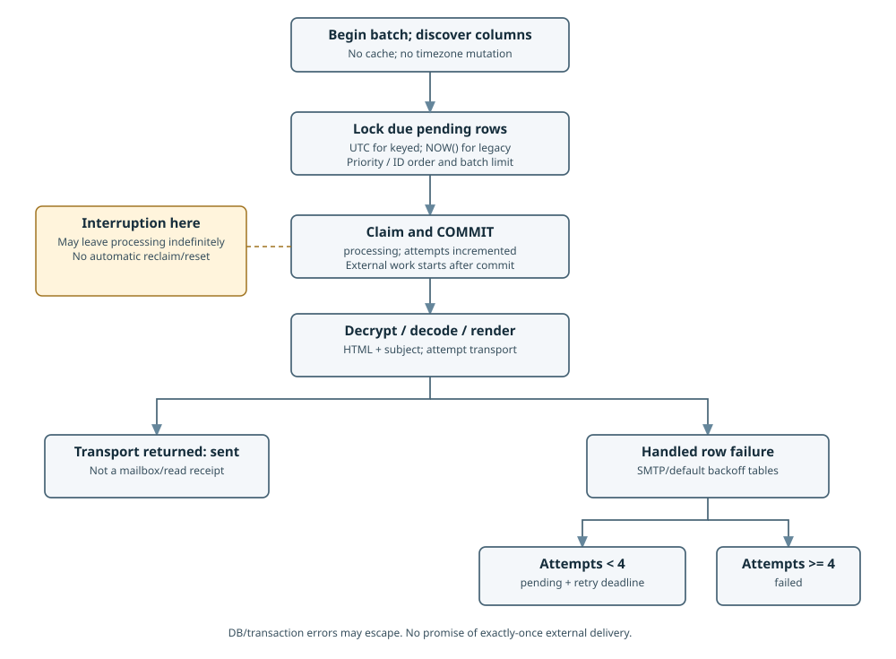

# Worker lifecycle and clocks

[Book](README.md) · [Worker setup](../how-to/setup-worker.md) · [Retry details](retry-mechanism.md)

`EmailQueueWorker::processBatch(int $limit=50): void` processes one batch; it is not a daemon.
The application supplies an idle PDO connection, real crypto contexts, renderer, transport and PSR-3
logger. Prefer exception-mode PDO. The worker's transaction ownership differs from the guarded
[keyed enqueue ports](../reference/idempotency.md); do not wrap a worker batch in a caller transaction.

1. Begin a transaction and discover queue columns with `SELECT * ... LIMIT 0` result metadata.
2. Lock due `pending` rows in priority/ID order with `FOR UPDATE` and a batch limit.
3. Set `processing`, increment attempts and commit the claim before external work.
4. Decrypt recipient/payload, decode JSON, inject `lang` from payload language, render and call transport.
5. On a returned transport call, record `sent`; handled row failures are retried or marked `failed`.

## Clock domains

| Row/table | Due and retry comparison | `retry_after` calculation | `sent_at` |
| --- | --- | --- | --- |
| Keyed: non-NULL `enqueue_receipt_id` | Database `UTC_TIMESTAMP()` | Database UTC plus the existing delay | Database UTC |
| Legacy: NULL token | Database-local `NOW()` | PHP-local `date()` plus delay | Database-local `NOW()` |
| Legacy table before 003, no token column | Original legacy path | Original legacy path | Original legacy path |

Keyed processing is independent of PHP/worker PDO timezone. The worker never changes the session
zone. It rediscovers metadata within each batch transaction instead of caching an old schema decision;
metadata/query failure is not treated as absence of the column. Existing SQLite legacy fixtures use the
no-column path; production keyed storage is MySQL/MariaDB. Operators must still align legacy writer,
worker DB and PHP timezones as before; the upgrade does not rewrite legacy timestamps.

## Failure and recovery limits

Normal row errors use the [fixed delay tables](retry-mechanism.md). Batch/transaction/query failures
and errors while persisting outcomes can escape; the caller must handle them. Logs can include
underlying dependency messages, so protect/redact them rather than dumping raw exception text.

The pending claim is committed before rendering/SMTP. No lease, reclaimer or reset of interrupted
`processing` rows is implemented. Restarting the worker, or replaying the same keyed enqueue, does
not reset such rows. A transport may accept a message before a timeout; an SMTP success followed by
DB failure may also be ambiguous. Investigation and recovery policy belong to the operator/application;
this guide does not authorize bulk resets or promise exactly-once delivery.
